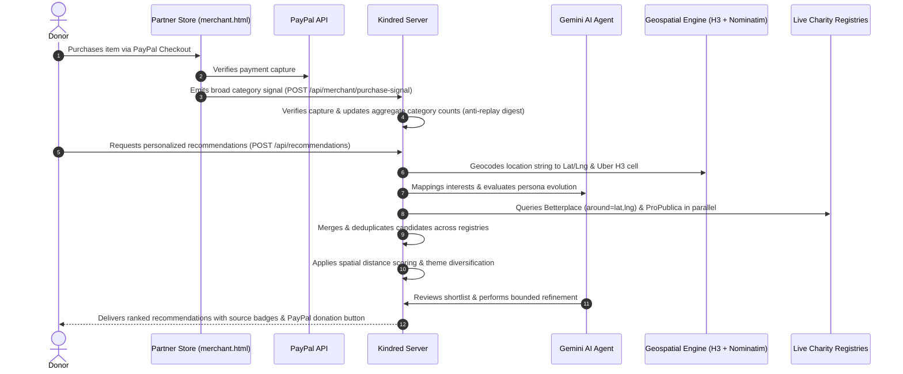
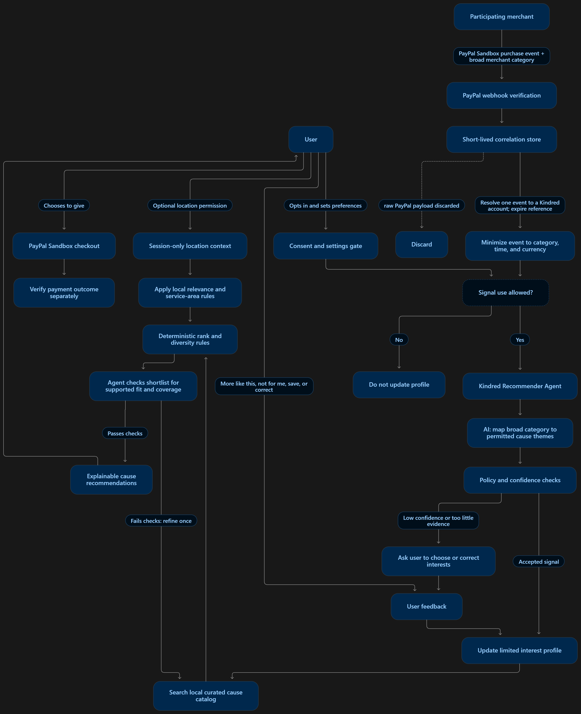

# Kindred 🕊️

> **Privacy-First Cause Discovery connecting verified PayPal merchant purchase signals to an autonomous Gemini AI agent that surfaces vetted local NGOs for seamless in-app donations.**

[](https://developer.paypal.com/)
[](https://ai.google.dev/)
[](https://h3geo.org/)
[](LICENSE)

---

<p align="center">
  
</p>

---

## 📖 Table of Contents

- [The Vision & Problem](#-the-vision--problem)
- [How Kindred Works](#-how-kindred-works)
- [System Architecture](#-system-architecture)
- [Key Features & Innovations](#-key-features--innovations)
  - [1. Privacy-First Merchant Signal Contract](#1-privacy-first-merchant-signal-contract)
  - [2. Autonomous Gemini AI Persona Engine](#2-autonomous-gemini-ai-persona-engine)
  - [3. High-Precision Geospatial Indexing (H3 + Nominatim)](#3-high-precision-geospatial-indexing-h3--nominatim)
  - [4. Dynamic Multi-Registry Discovery & Deduplication](#4-dynamic-multi-registry-discovery--deduplication)
  - [5. Visual Signal Transparency (Animated Badges)](#5-visual-signal-transparency-animated-badges)
  - [6. Verified PayPal Donation Checkout](#6-verified-paypal-donation-checkout)
- [Interactive Demo Walkthrough](#-interactive-demo-walkthrough)
- [Getting Started (Run Locally)](#-getting-started-run-locally)
  - [Prerequisites](#prerequisites)
  - [Installation & Setup](#installation--setup)
  - [Running the App](#running-the-app)
- [API Reference](#-api-reference)
- [Data & Privacy Integrity](#-data--privacy-integrity)
- [Testing](#-testing)
- [License](#-license)

---

## 💡 The Vision & Problem

Modern donors want to support impactful, grassroots causes close to their community, but face two massive obstacles:

1. **Discovery & Distance:** Traditional charity platforms prioritize giant multinational nonprofits, burying effective local community schools, food banks, and shelters.
2. **The Privacy Dilemma:** Personalizing charitable recommendations normally requires invasive profiling—scraping bank statements, tracking itemized receipts, or harvesting physical addresses.

**Kindred solves this without ever invading user privacy.** 

By partnering with e-commerce merchants at checkout, Kindred receives only **broad, aggregated retail category signals** (e.g., `sporting_goods`, `pet_supplies`, `media_books`) tied to an authenticated PayPal Payer ID. An autonomous **Google Gemini AI Agent** analyzes these high-level signals alongside user preferences, computes spatial proximity using **Uber H3 hexagonal indexing**, and recommends vetted local organizations ready for direct PayPal donations.

---

## 🛠️ How Kindred Works



---

## 🏗️ System Architecture

<p align="center">
  
</p>

Kindred is composed of modular, privacy-preserving layers:

* **Merchant Integration Layer:** Partner e-commerce stores emit minimal purchase signals upon successful PayPal capture via HMAC-authenticated webhooks.
* **Consent & Payer Correlation Store:** Session-scoped store that maps authenticated PayPal Payer IDs to high-level category counters while enforcing strict user opt-in.
* **Autonomous Gemini Agent (`src/recommendation-agent.ts`):** Orchestrates multi-step cause discovery, persona evaluation, confidence scoring, and shortlist validation using the Google Gemini SDK.
* **Geospatial & Spatial Indexing Engine (`src/geo.ts`):** Employs Uber H3 hexagonal grid cells (Resolution 3) and OpenStreetMap Nominatim reverse geocoding to calculate local proximity without persisting user GPS coordinates.
* **Dynamic Multi-Registry Aggregator (`src/catalog.ts`):** Concurrently searches unauthenticated public charity APIs (Betterplace.org & ProPublica Nonprofit Explorer), dynamically deduplicating by normalized entity name and domain.
* **Direct PayPal Checkout (`src/paypal.ts`):** Generates PayPal v2 orders routing funds directly to reviewed recipient merchant accounts.

---

## ✨ Key Features & Innovations

### 1. Privacy-First Merchant Signal Contract
Kindred never reads personal bank accounts or transaction histories. Merchants transmit an ultra-minimal payload:
```json
{
  "payerId": "QZAZCPCBP7VUC",
  "category": "sporting_goods",
  "captureId": "CAP-PAYPAL-20261108-001X",
  "merchantId": "25WJ3Q5B5XNQE",
  "timestamp": "2026-11-08T02:15:00Z"
}
```
* **Strictly Excluded:** No item names, no product descriptions, no basket amounts, no credit card details, and no shipping addresses.
* **Replay Protection:** A keyed 30-day HMAC capture digest prevents duplicate submissions or signal spamming.

### 2. Autonomous Gemini AI Persona Engine
Unlike static keyword matchers, Kindred uses **Google Gemini** to build a rich persona over time:
* **Graduated Multi-Purchase Weighting:** A single one-off purchase does not abruptly derail recommendations. Kindred uses a graduated dampening curve:
  $$\text{purchaseWeight} = \min(8.0, 2.5 + \text{count} \times 2.0)$$
* **Persona Conflict Resolution:** If explicit user preferences conflict with emerging purchase habits, Gemini assesses intent, maintains theme variety, and provides clear human-readable rationales.
* **Confidence Scaling:** Adjusts confidence dynamically from baseline ($0.25$) to high certainty ($0.85$) as consistent multi-month purchase signals accumulate.

### 3. High-Precision Geospatial Indexing (H3 + Nominatim)
* **Zero-API-Key Geocoding:** Converts user-provided location strings (e.g., `"Lagos, Nigeria"`, `"Abuja"`, `"London"`) or GPS coordinates into latitude and longitude via OpenStreetMap Nominatim.
* **Uber H3 Hexagonal Grid:** Discretizes coordinates into global H3 hexagonal cells (`latLngToCell`). Proximity is computed via grid ring distance decay.
* **True Spatial API Queries:** Queries Betterplace with `around=lat,lng&around_distance=150km`, activating the upstream spatial index to return grassroots charities operating directly within the user's vicinity.
* **Local Priority Boost:** Local and regional causes within 150 km receive a significant ranking advantage over distant international aggregations.

### 4. Dynamic Multi-Registry Discovery & Deduplication
* **Zero Hardcoded Charities:** Kindred does not hardcode static charity arrays. Causes are discovered in real time from live, public endpoints.
* **Dual Unauthenticated APIs:**
  * **Betterplace API v4:** Live grassroots international and African initiatives with native GPS coordinates and fundraising progress.
  * **ProPublica Nonprofit Explorer API:** Comprehensive registry of IRS-registered 501(c)(3) public charities (completely free, zero API key required).
* **Intelligent Cross-Source Deduplication:** Merges overlapping listings by canonical ID, normalized legal name (stripping suffixes like *Inc.*, *Ltd.*, *Foundation*, *e.V.*), and official domain URL. Field merging keeps the richest mission summary and spatial attributes.

### 5. Visual Signal Transparency (Animated Badges)
Donors always know *why* a cause was recommended:
* **`🛍️ Merchant Signal` Badge:** Features a ripple dot animation and pulse icon to indicate causes surfaced through verified purchase patterns (e.g., sports equipment $\rightarrow$ youth athletics).
* **`🎯 Your Preference` Badge:** Highlights causes chosen based on the donor's explicitly selected cause areas.

### 6. Verified PayPal Donation Checkout
* Direct in-app donation modal powered by PayPal Web SDK v6.
* Funds route directly to verified recipient merchant accounts (`recipientMerchantId`).
* Donations remain disabled for unverified listings until identity and payee eligibility are validated.

---

## 🎮 Interactive Demo Walkthrough

Kindred includes a built-in mock e-commerce store (`public/merchant.html`) and a pre-configured 3-month simulated purchase history to test the AI's adaptation in real time.

```
       ┌───────────────────────────────┐
       │   Kindred Web App             │
       │   http://localhost:3000       │
       └──────────────┬────────────────┘
                      │ 1. Link Demo Payer ID: QZAZCPCBP7VUC
                      ▼
       ┌───────────────────────────────┐
       │   Baseline Persona:           │
       │   "Quiet Nature Reader"       │
       │   (Books, Garden, Food)       │
       │   Surfaces: Environment NGOs  │
       └──────────────┬────────────────┘
                      │ 2. Visit Demo Store
                      ▼
       ┌───────────────────────────────┐
       │   Demo Store (merchant.html)  │
       │   http://localhost:3000/      │
       │   merchant                    │
       │   Buy: Chess Set or Vet Kit   │
       └──────────────┬────────────────┘
                      │ 3. Click "⚡ Demo Checkout"
                      ▼
       ┌───────────────────────────────┐
       │   Return to Kindred & Refresh │
       │   Gemini detects new signals  │
       │   Pivots to: Youth Sport &    │
       │   Animal Shelters             │
       │   (Marked with 🛍️ badge)      │
       └───────────────────────────────┘
```

1. **Start Kindred:** Open `http://localhost:3000`.
2. **Onboarding:** Enter the demo PayPal Payer ID `QZAZCPCBP7VUC`. Enter your location as `"Lagos, Nigeria"` (or use the **Use my live location** button).
3. **Inspect Baseline:** Kindred analyzes the 3-month baseline history (heavy on books, garden, and food) and recommends environmental and nutrition programs.
4. **Trigger Live Merchant Signal:** Open `http://localhost:3000/merchant` in another tab. Add contrasting items to your cart (e.g., **Championship Wooden Chess Set** under `sporting_goods` or **Emergency Pet Rescue First Aid Kit** under `pet_supplies`). Click **⚡ Demo Checkout**.
5. **Watch the AI Pivot:** Return to Kindred and click **Refresh**. Notice that the recommendations instantly pivot to Youth Sports (`Chess in Slums`) or Animal Welfare, tagged with the animated **`🛍️ Merchant Signal`** badge!

---

## 🚀 Getting Started (Run Locally)

### Prerequisites
* **Node.js:** v18.0.0 or higher
* **pnpm:** v10.0.0+ (recommended) or npm
* **Google Gemini API Key:** (Free from [Google AI Studio](https://aistudio.google.com/))
* **PayPal Sandbox Account:** (Optional for live checkout, from [PayPal Developer](https://developer.paypal.com/))

### Installation & Setup

1. **Clone the repository:**
   ```bash
   git clone https://github.com/Favour-chuks/Kindred.git
   cd Kindred
   ```

2. **Install dependencies:**
   ```bash
   pnpm install
   ```

3. **Configure Environment Variables:**
   Create `.env.local` by copying the example template:
   ```bash
   cp .env.example .env.local
   ```
   Open `.env.local` and add your Gemini API key:
   ```env
   NODE_ENV=development
   PORT=3000

   # AI Recommendation Agent
   GEMINI_API_KEY=your_gemini_api_key_here
   GEMINI_MODEL=gemini-2.5-flash

   # PayPal Sandbox Credentials (for direct donation captures)
   PAYPAL_CLIENT_ID=your_paypal_client_id
   PAYPAL_CLIENT_SECRET=your_paypal_client_secret
   PAYPAL_BASE_URL=https://api-m.sandbox.paypal.com

   # Merchant Signal Security
   KINDRED_MERCHANT_SHARED_SECRET=development-secret-key-12345
   KINDRED_MERCHANT_PAYPAL_ID=25WJ3Q5B5XNQE
   ```

### Running the App

Run both the Express backend API and the Vite React frontend concurrently:
```bash
pnpm dev
```

* **Kindred Donor App:** [http://localhost:3000](http://localhost:3000)
* **Partner Merchant Store (Demo):** [http://localhost:3000/merchant](http://localhost:3000/merchant)

To build for production:
```bash
pnpm build
pnpm start
```

---

## 📡 API Reference

| Method | Endpoint | Description | Auth / Security |
|---|---|---|---|
| `POST` | `/api/profiles` | Create or update a donor profile and consent flags | Open |
| `POST` | `/api/recommendations` | Asynchronously generates AI recommendations with spatial H3 indexing | Session-scoped |
| `GET` | `/api/recommendations/:jobId` | Polls recommendation job progress, activity log, and ranked causes | Session-scoped |
| `POST` | `/api/merchant/purchase-signal` | Ingests verified retail purchase category signals from merchants | `x-kindred-merchant-key` (HMAC) |
| `POST` | `/api/merchant/demo-simulate-checkout` | Sandbox instant checkout simulation for demo testing | Open |
| `POST` | `/api/orders` | Initiates a PayPal donation order with verified recipient payee | Verified NGO status |
| `POST` | `/api/orders/:id/capture` | Captures donation and updates local campaign metrics | PayPal Signature verification |
| `POST` | `/api/feedback` | Records user feedback (`more_like_this` or `not_for_me`) | Session-scoped |

---

## 🔒 Data & Privacy Integrity

Kindred is built around privacy-by-design principles:

1. **No Sensitive Transaction Data:** Kindred never stores or processes item descriptions, SKU numbers, transaction amounts, card numbers, or physical delivery addresses.
2. **Ephemeral Geolocation:** User coordinates are used purely in-memory during the recommendation request to calculate H3 hexagonal cells and query radius endpoints. GPS coordinates are never written to any database.
3. **Anti-Replay Protection:** PayPal capture references are cryptographically digested (`SHA-256`) with a 30-day expiration window to prevent signal replay.
4. **Deterministic Fallbacks:** If the Gemini API is unreachable, Kindred gracefully degrades to transparent, deterministic category mapping rules without interrupting user experience.

---

## 🧪 Testing

Kindred includes a test suite covering geospatial math, cross-API deduplication, transaction sanitization, and matching logic:

```bash
# Run unit and integration tests
pnpm test

# Run TypeScript typechecks
pnpm typecheck
```

---

## 📄 License

This project is licensed under the [MIT License](LICENSE).
